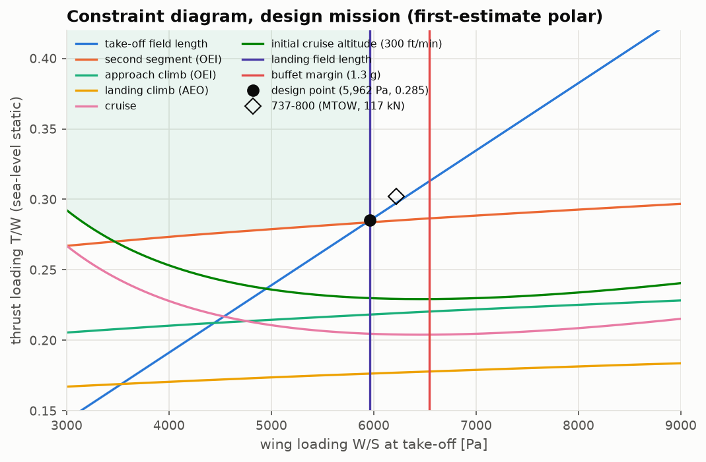
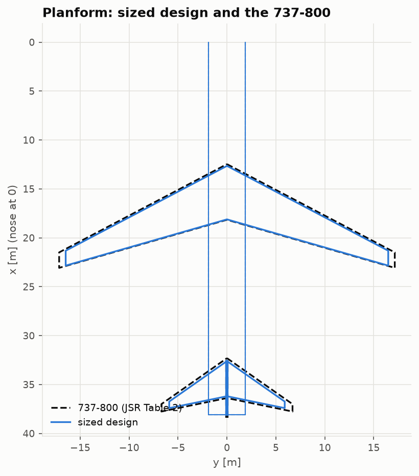
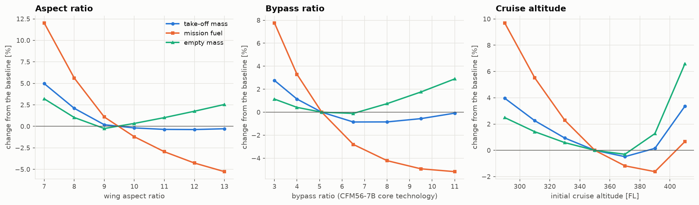

# Aircraft Conceptual Design From Scratch

[](https://github.com/GMCavalheri/aircraft-conceptual-design-from-scratch/actions/workflows/ci.yml)

A conceptual design and sizing tool for transport aircraft, built on four earlier projects,
which it imports as libraries:
- [aerodynamics](https://github.com/GMCavalheri/aerodynamics-from-scratch) (AERO-01)
- [structures](https://github.com/GMCavalheri/aircraft-structures-from-scratch) (AERO-02)
- [propulsion](https://github.com/GMCavalheri/propulsion-from-scratch) (AERO-03)
- [flight dynamics](https://github.com/GMCavalheri/flight-dynamics-from-scratch) (AERO-04)

From mission requirements to a sized aircraft:
- mission requirements and a cited reference aircraft;
- class I and class II weight estimation, closed on take-off weight;
- the T/W–W/S constraint diagram, with the real engine's thrust lapse;
- wing and tail sizing, with vortex-lattice aerodynamics and a component drag build-up;
- a physics-based wing-box check against the statistical wing weight;
- mission performance by time integration, and stability and flying qualities;
- trade studies in which every point is a re-sized aircraft.

The design is checked at every level against the **Boeing 737-800**. Its data is transcribed
with page numbers from Boeing's airport-planning document and Jenkinson et al.'s data tables.
The airframe has **no calibration**.

**New to the subject? Start with the [eight-lesson course](docs/lessons/README.md).
The results are collected in the [design report](docs/design-report.md).**

<p align="center">
  
  
  
</p>

## What's inside

| Module | Method | Verified / validated against |
|---|---|---|
| [`requirements`](src/acdesign/requirements) | mission dataclass; every input labelled data / assumption / deduction | the 737-800's payload-range envelope |
| [`weight_estimation`](src/acdesign/weight_estimation) | Raymer class I and Breguet fractions; class II with Raymer (structure) and FLOPS (systems, interior, operating items) | closed forms; **737-800 OEW from its own geometry: −11.7 %** |
| [`constraint_analysis`](src/acdesign/constraint_analysis) | Loftin field lengths, FAR 25 climbs, Mattingly master equation, buffet margin | master-equation minimum = 1/(L/D)max; the 737's charts imply CLmax,TO = 2.09 |
| [`wing_tail_sizing`](src/acdesign/wing_tail_sizing), [`sizing`](src/acdesign/sizing.py) | VLM with the Göthert rule, drag build-up, Korn wave drag, tail volumes, closure on W0 | VLM vs DATCOM 2–4 %; far-wake downwash vs AERO-01 Trefftz plane to 1e-5 |
| [`structural_sizing_check`](src/acdesign/structural_sizing_check) | skin-stringer wing box on AERO-02's beam, sections, buckling and S-N curves | **physics wing within 2 % of the statistical wing** |
| [`performance_verification`](src/acdesign/performance_verification) | time-integrated mission; CG build-up; derivatives from geometry (VLM roll derivatives); AERO-04 trim and modes | AERO-04 static margin vs textbook neutral point: 1.5 % MAC; MIL-F-8785C |
| [`trade_studies`](src/acdesign/trade_studies) | aspect ratio, bypass ratio, cruise altitude, W/S × T/W carpet | the constraint design point is the lightest feasible point |
| [`external`](src/acdesign/external) | the only imports of the four pillar packages | **AERO-03's engine results reproduced to the printed digit** |

## Headline results

| | sized design | 737-800 | |
|---|---|---|---|
| take-off mass | 70.0 t | 79.0 t | −11.5 % |
| empty mass (OEW) | 33.7 t | 41.4 t | −18.7 % |
| mission fuel | 20.0 t | 21.3 t | −6.1 % |
| wing area | 115 m² | 125 m² | −7.6 % |
| thrust per engine | 98 kN | 117 kN | −16.4 % |

Independent checks place the gap in one stage:
- the drag build-up on both geometries agrees to 0.3 %;
- the engine reproduces AERO-03;
- the physics-based wing agrees with the statistical wing to 2 %;
- but the class II empty weight is already 11.7 % low on the 737's own geometry.

A growth factor of 2.2 turns that bias into the −11.5 % in take-off mass.

Other findings:
- Time integration flies the mission 5 % further than the Breguet sizing.
- The design needs a yaw damper, as swept-wing transports do.
- The landing-limited wing is 8 % short of fuel volume.
- The LEAP-1B saves 8.2 % mission fuel over the CFM56-7B.

## Quickstart

Requires [uv](https://docs.astral.sh/uv/). The pillar packages install from GitHub, pinned
to a commit.

```bash
uv sync
uv run pytest
```

```python
from acdesign.requirements import B737_800_MISSION
from acdesign.sizing import Design, size_aircraft

a = size_aircraft(B737_800_MISSION)
print(f"{a.W0:,.0f} kg, S = {a.S:.1f} m2, T = {a.thrust / 1e3:.1f} kN")
# 69,962 kg, S = 115.1 m2, T = 97.8 kN

b = size_aircraft(B737_800_MISSION, Design(AR=12.0))  # re-size with another wing
```

Regenerate every figure and results table, and the notebooks:

```bash
uv run python validation/run_all.py
```

```bash
uv run python notebooks/build_notebooks.py
```

## Layout

```
src/acdesign/   requirements, weight_estimation, constraint_analysis, wing_tail_sizing,
                structural_sizing_check, performance_verification, trade_studies,
                sizing.py (the closed loop), external/ (the four pillar packages)
validation/     reference data with citations, one script per comparison, results/
docs/           course (lessons/), theory notes, design report, figures
notebooks/      one executed demo per lesson
tests/          89 tests: closed forms, cross-project, consistency, the reference aircraft
```

## Data sources

- Boeing, *Next-Generation 737 Airplane Characteristics for Airport Planning*, D6-58325-7
  Rev C (2025): weights, dimensions, cabin, payload-range and field-length charts.
- L. R. Jenkinson, P. Simpkin & D. Rhodes, *Civil Jet Aircraft Design* (1999), Data A,
  Table 2: wing and tail geometry.
- ICAO Aircraft Engine Emissions Databank (Issue 32) and EASA TCDS E.004 / E.115, via
  AERO-03.
- Methods: Raymer, FLOPS (NASA/TM-2017-219627), Loftin (NASA RP-1060), Mattingly,
  Torenbeek, Etkin & Reid, MIL-F-8785C. Each is cited where it is used.

## License

MIT.
