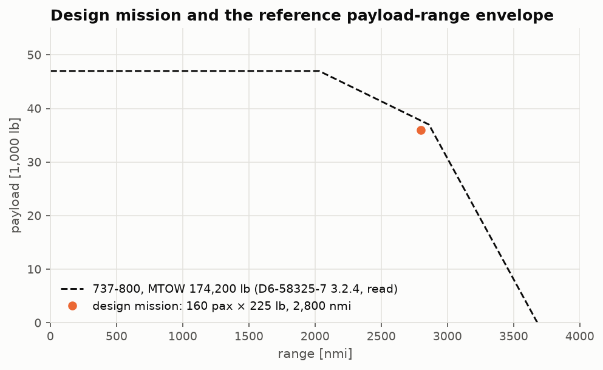
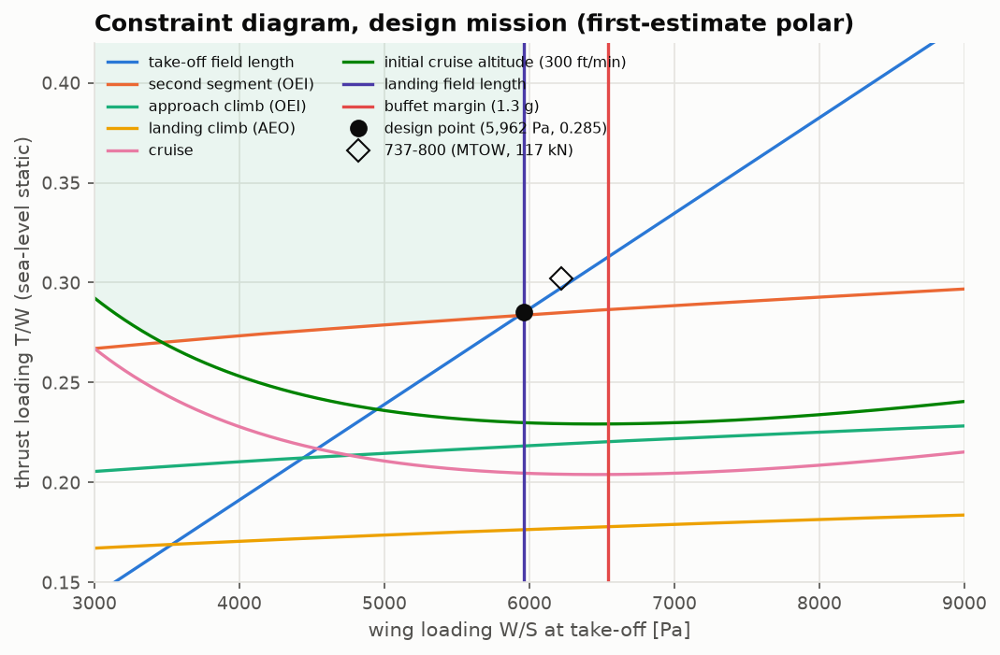
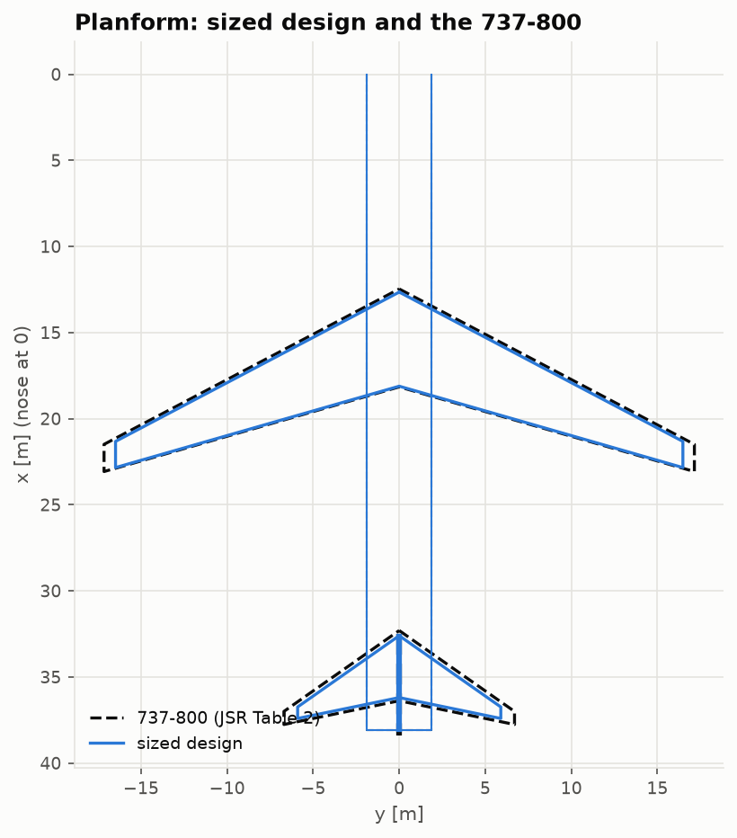
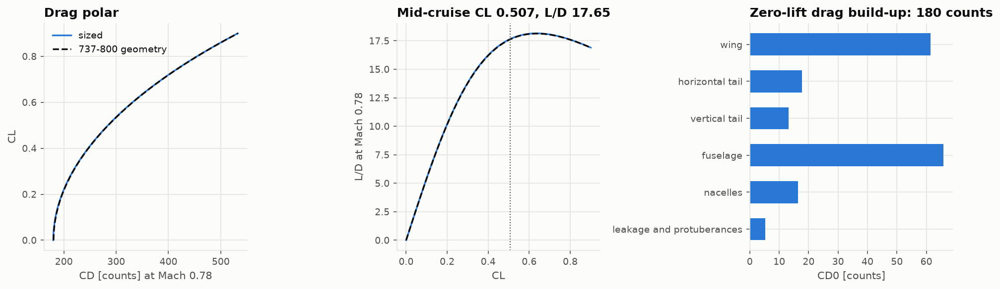
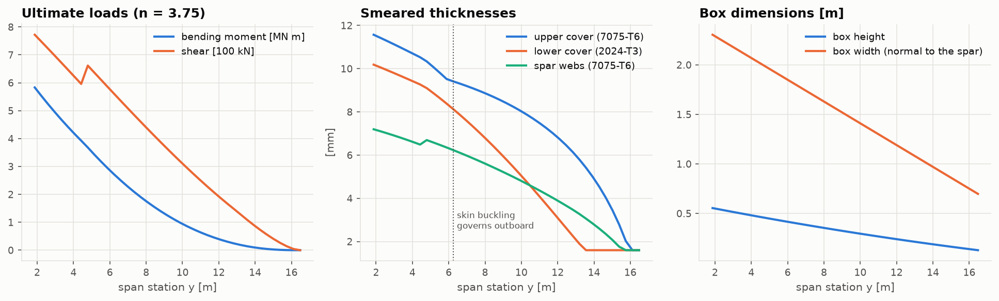
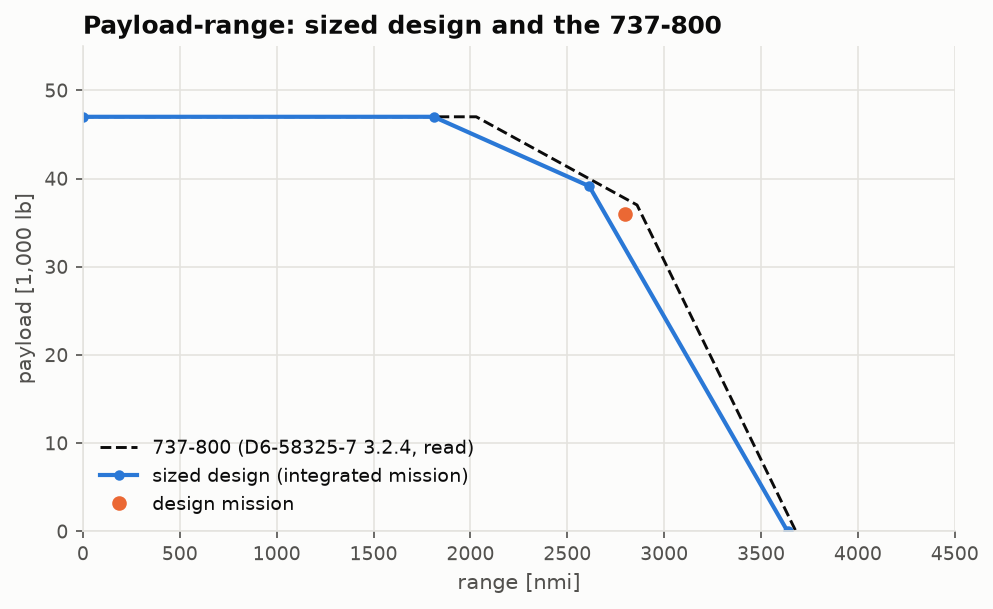
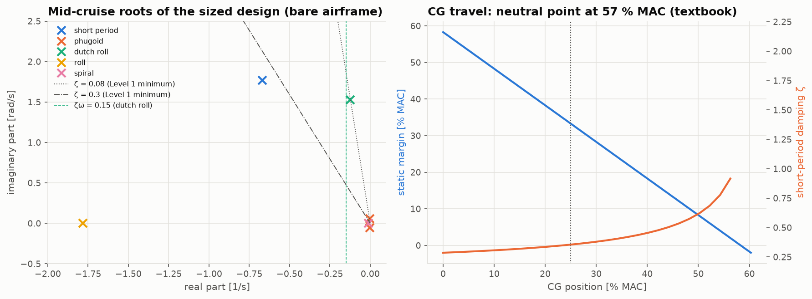
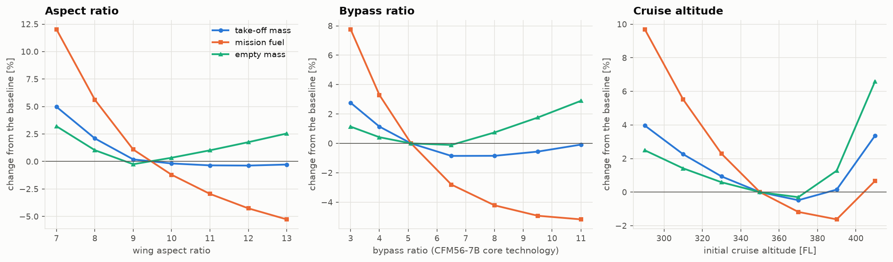
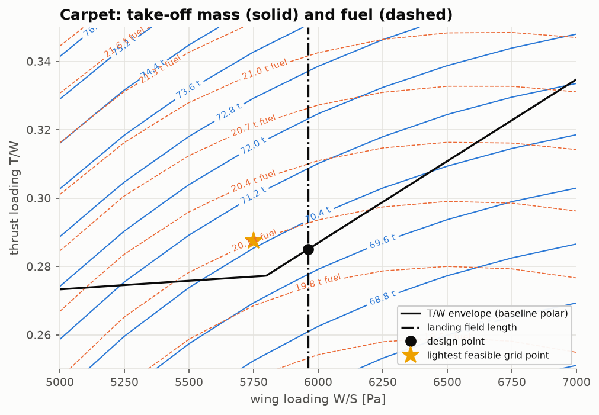

# Conceptual design report: a 160-seat, 2,800 nmi twin-jet

*Sized from its requirements with the four From Scratch pillar packages, and validated
against the Boeing 737-800.*

Every number below comes from a script in [`validation/`](../validation)
(`uv run python validation/run_all.py`), whose tables are in
[`validation/results/`](../validation/results). The methods are explained in the
[course](lessons/README.md) and the theory notes.

## 1. Summary

| | sized design | 737-800 | |
|---|---|---|---|
| take-off mass | 69,962 kg | 79,015 kg (MTOW) | −11.5 % |
| operating empty mass | 33,661 kg | 41,413 kg | −18.7 % |
| design-mission fuel, with reserves | 19,972 kg | 21,273 kg (MTOW − OEW − payload) | −6.1 % |
| wing area / span | 115.1 m² / 33.0 m | 124.6 m² / 34.3 m | −7.6 % / −4.0 % |
| thrust per engine (SLS) | 97.8 kN | 117.0 kN | −16.4 % |
| wing loading / thrust loading | 5,962 Pa / 0.285 | 6,219 Pa / 0.302 | −4.1 % / −5.6 % |
| cruise L/D, TSFC | 17.65, 17.13 mg/(N·s) | — | |

The chain of textbook methods sizes the mission to an aircraft recognisably like the 737-800.
It is about 12 % lighter, and the difference is traced to one source: the class II empty
weight, which is 11.7 % low *at the 737's own geometry*. The aerodynamics, engine and wing
structure all check against independent methods to within a few per cent. Nothing in the
airframe is calibrated.

## 2. Requirements

- **Payload:** 160 passengers (12 first, 148 economy), 225 lb each with baggage: 36,000 lb.
- **Range:** 2,800 nmi, cruising at Mach 0.78 at FL350.
- **Reserves:** 5 % contingency, a 200 nmi diversion and a 30 min hold at 1,500 ft.
- **Field lengths:** FAR take-off 7,800 ft at MTOW and FAR landing 5,800 ft at MLW, both sea
  level and standard day, as read from the 737-800's airport-planning charts.

The 737-800 flies this mission at its MTOW to about 1 %, so MTOW is the right comparison
([Lesson 1](lessons/01-requirements-and-reference.md)).

## 3. Method

| step | method | pillar package |
|---|---|---|
| constraint diagram | Loftin field lengths, FAR 25 climb gradients, Mattingly master equation, buffet margin | engine lapse: AERO-03 |
| geometry | trapezoidal wing from W/S, tails by volume coefficient, rubber engines | — |
| aerodynamics | VLM lift slope (Göthert), span efficiency, downwash; component drag build-up; Korn wave drag | VLM: AERO-01 |
| weights | Raymer structure and propulsion, FLOPS systems and operating items | engine mass: TCDS |
| mission fuel | segment fractions, Breguet at the polar's L/D and the engine's part-power TSFC | AERO-03 |
| closure | secant iteration on W0, 4 iterations | — |
| structure check | wing-box sizing (column, skin buckling, Ftu, fatigue, shear buckling) | beam, sections, buckling, S-N: AERO-02 |
| performance check | time-integrated climb, cruise, descent | AERO-03 |
| stability check | CG build-up, derivatives from geometry, trim, modes | AERO-04 (and AERO-01 for wing roll derivatives) |

## 4. Sizing

The landing field length sets the wing loading at 5,962 Pa, with an assumed landing CLmax of
2.7. The take-off field length sets the thrust loading at 0.285, with the one-engine-out
second-segment climb close behind at 0.284. Cruise needs only 0.205.

| geometry | sized |
|---|---|
| wing | S 115.1 m², A 9.44, λ 0.278, Λ 25°; b 33.0 m, $c_r$ 5.46 m, MAC 3.86 m |
| horizontal tail | 25.1 m² (V_H 1.00), span 11.8 m, arm 17.7 m |
| vertical tail | 19.3 m² (V_V 0.09), height 5.5 m |
| fuselage | 38.08 × 3.73 m (the 737-800's; the cabin is fixed by the mission) |
| engines | 2 × 97.8 kN rubber CFM56-7B26/3; nacelle 4.37 × 1.88 m |

| mass group | sized [kg] | class II at the 737 geometry [kg] |
|---|---|---|
| structure | 16,978 | 18,900 |
| propulsion | 4,224 | 5,092 |
| systems and furnishings | 10,537 | 10,644 |
| operating items | 1,922 | 1,935 |
| **OEW** | **33,661** | **36,571** (published 41,413) |
| payload | 16,329 | |
| fuel (design mission) | 19,972 | |
| **take-off mass** | **69,962** | |

The drag build-up gives CD0 = 180 counts: fuselage 66, wing 61, tails 31, nacelles 16,
leakage 5. Oswald e is 0.810. The mid-cruise CL is 0.507, at an L/D of 17.65; wave drag is
under a count, with $M_{dd}$ ≈ 0.85.

## 5. Structural check

A wing box sized for 3.75 g ultimate weighs 2,334 kg ideal. With a non-optimum factor of 1.5
and 15 kg/m² of secondary structure (assumptions fixed beforehand), the wing comes to
5,227 kg, against Raymer's 5,315 kg (0.98). On the 737-800 geometry the ratio is 0.99. The
1-g tip deflection is 0.91 m, 5.5 % of the semispan.
([Lesson 5](lessons/05-structural-sizing-check.md))

## 6. Performance

Flown by time integration with the sized fuel, the mission reaches **2,943 nmi** (+5.1 %).
Climb takes 156 nmi and 1,586 kg; cruise 2,676 nmi and 12,274 kg; descent 110 nmi; reserves
of 3,543 kg are held back. The payload-range diagram runs just inside the 737-800's chart.

**Finding:** the design fuel is 108 % of the 737's tank volume scaled by $S^{1.5}$. The
landing-limited wing is too small to hold it in similar tanks, and needs a larger centre
tank or a larger wing.

## 7. Stability and flying qualities

The wing is placed for a 25 % MAC mid-cruise CG; the empty CG falls at 22 %. The wing-body
aerodynamic centre is at 19.5 % MAC: the VLM puts the wing's at 31.5 %, and Torenbeek's
fuselage shift moves it forward. The neutral point is at 56.8 % (textbook). AERO-04 gives a
**33.3 %** static margin, which agrees with the textbook to 1.5 % MAC.

| MIL-F-8785C Level 1, Class III, Cat. B | value | |
|---|---|---|
| short-period damping 0.30–2.00 | 0.355 | met |
| phugoid damping ≥ 0.04 | 0.035 | not met (Lanchester: 1/(√2 L/D) = 0.040) |
| dutch roll ζ ≥ 0.08, ω ≥ 0.4 rad/s | 0.081, 1.53 | met |
| dutch roll ζω ≥ 0.15 rad/s | 0.125 | **not met — needs a yaw damper** |
| roll time constant ≤ 1.4 s | 0.56 s | met |
| spiral time to double ≥ 20 s | stable | met |

## 8. Trade studies

- **Aspect ratio.** Fuel falls monotonically with A (−5 % at A = 13). W0 is flat from
  A = 10 to 13 and lightest near 12. Below A = 9, the second-segment climb takes over and
  the engines grow fast.
- **Bypass ratio** (rubber engines of the CFM56-7B core). W0 is lightest at BPR 6.5–8.
  Fuel keeps falling, with diminishing returns. The calibrated **LEAP-1B28 saves 8.2 %
  mission fuel**.
- **Cruise altitude.** The lightest design cruises at FL370. Above it, the 1.3 g buffet
  margin limits the wing loading and the wing grows.
- **Carpet.** No feasible point of a 9 × 9 W/S–T/W grid is lighter than the constraint
  design point. "Highest feasible W/S, least T/W" is the minimum-weight choice here.

## 9. Validation and its limits

The checks, from closed forms up to the reference aircraft, are collected in
[Lesson 8](lessons/08-verification-and-validation.md).

| quantity | agreement | basis |
|---|---|---|
| AERO-03 engine through the adapter | to the printed digit | Tt4, airflow, take-off and cruise TSFC |
| VLM lift slope vs DATCOM | 2–4 % | Mach 0–0.8, tapered planforms |
| VLM downwash vs DATCOM | 11–14 % (VLM higher) | flat-wake model |
| class I W0 vs 737-800 MTOW | +1.7 % | partly fortuitous (statistical L/D) |
| class II OEW vs 737-800 | −11.7 % | uncalibrated statistics; systems and interior suspected |
| physics wing vs class II wing | −2 % / −1 % | assumed non-optimum factor |
| integrated range vs Breguet requirement | +5.1 % | climb and descent distance |
| AERO-04 static margin vs textbook | 1.5 % MAC | tail-arm definition |
| sized W0, S, T vs 737-800 | −11.5 %, −7.6 %, −16.4 % | the OEW bias × growth factor 2.2 |

**Limitations.**
- The engine is uninstalled: no bleed or power offtake.
- Mach derivatives are left at zero in the stability model.
- The lower-cover fatigue model, with Kt = 2 and one cycle per flight, does not bind;
  real covers are fatigue-designed.
- High-lift CLmax values are assumptions; the 737's own field lengths imply 2.09 for
  take-off and 2.82 for landing.
- The fuselage is the reference's.

A calibration factor on the empty mass, about 1.13, would close the weight gap by
construction. It is the right tool for derivative studies, where only differences matter,
and is deliberately not applied here.

## References

- Boeing, *Next-Generation 737 Airplane Characteristics for Airport Planning*, D6-58325-7
  Rev C, October 2025.
- L. R. Jenkinson, P. Simpkin & D. Rhodes, *Civil Jet Aircraft Design*, Arnold, 1999 (Data A).
- D. P. Raymer, *Aircraft Design: A Conceptual Approach*, AIAA.
- D. P. Wells, B. L. Horvath & L. A. McCullers, *The Flight Optimization System Weights
  Estimation Method*, NASA/TM-2017-219627, 2017.
- L. K. Loftin, *Subsonic Aircraft: Evolution and the Matching of Size to Performance*,
  NASA RP-1060, 1980.
- J. D. Mattingly, W. H. Heiser & D. T. Pratt, *Aircraft Engine Design*, AIAA.
- E. Torenbeek, *Synthesis of Subsonic Airplane Design*, Delft University Press.
- B. Etkin & L. D. Reid, *Dynamics of Flight: Stability and Control*, Wiley.
- MIL-F-8785C, *Flying Qualities of Piloted Airplanes*, 1980.
- ICAO Aircraft Engine Emissions Databank, Issue 32; EASA TCDS E.004 and E.115 (through
  AERO-03).
