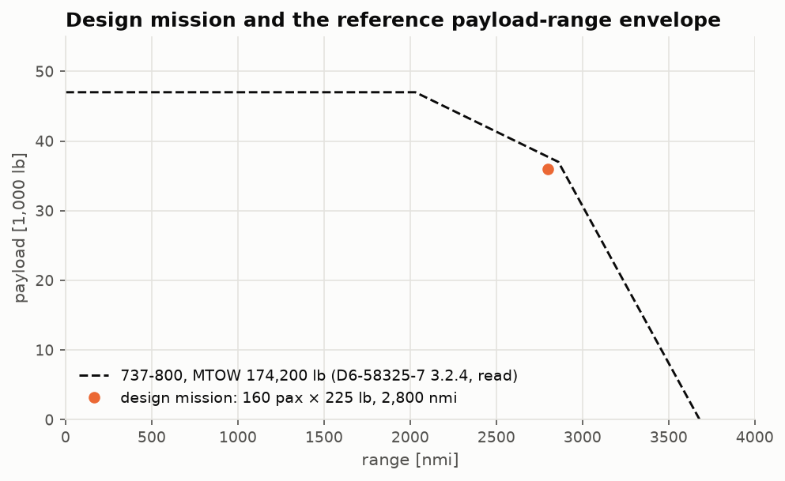

# Lesson 1 · Requirements and the reference aircraft

> *Conceptual design starts from what the aircraft must do, not from what it looks like.
> A handful of numbers — payload, range, speed, runway — fix almost everything that follows.
> Choosing them well, and choosing a real aircraft to check the answer against, is the first
> design decision.*

**Code:** [`src/acdesign/requirements/`](../../src/acdesign/requirements) ·
**Data:** [`validation/reference_data/b737_800.csv`](../../validation/reference_data/b737_800.csv) ·
**Notebook:** [`01_requirements.ipynb`](../../notebooks/01_requirements.ipynb) ·
**Next:** [Lesson 2 — Weight estimation](02-weight-estimation.md)

## Learning objectives

By the end of this lesson you should be able to

1. list the top-level requirements of a transport mission and say which design quantity
   each one drives;
2. read an airport-planning payload-range chart and turn it into a design mission;
3. tell data, assumptions, deductions and calibrations apart, and label every input;
4. explain why a reference aircraft is needed even when you design "from scratch".

---

## 1. The questions a mission answers

A transport aircraft is sized by a few requirements. Each one ends up binding one design
quantity:

| Requirement | Drives |
|---|---|
| passengers and cargo (payload) | fuselage; and, through the weight snowball, everything else |
| design range at that payload | fuel fraction, hence take-off weight |
| cruise Mach and altitude | wing sweep and thickness, engine cycle, cruise thrust |
| take-off field length | thrust loading T/W (with the take-off CLmax) |
| landing field length | wing loading W/S (with the landing CLmax) |
| one-engine-out climb gradients | thrust loading, for a twin |
| fuel reserves | extra fuel, hence weight |

Later lessons turn each line into an equation. This lesson fixes the numbers.

## 2. The reference aircraft

A design method made of statistics and simple physics can be off by tens of per cent
without anything looking wrong. The only defence is to run the same method on a real
aircraft whose answer is known. This project uses the **Boeing 737-800**: a well-documented
160-seat twin with CFM56-7B engines, the same engine family as the calibrated engine of
AERO-03.

Two public sources are transcribed, with page numbers, into
[`b737_800.csv`](../../validation/reference_data/b737_800.csv):

- Boeing, *Next-Generation 737 Airplane Characteristics for Airport Planning*, D6-58325-7
  Rev C (2025): weights, dimensions, cabin layout, payload-range and field-length charts;
- Jenkinson, Simpkin & Rhodes, *Civil Jet Aircraft Design* (1999), Data A, Table 2: wing and
  tail geometry (area, aspect ratio, taper, sweep, tail areas and arms).

Some values are read from charts. The CSV gives each chart value with its reading
resolution, for example 2,860 ± 30 nmi. The tests check the transcription against itself.
For instance, the airport-planning manual prints both pounds and kilograms, and the
payload-range chart must reproduce the fuel capacity from the weight table:

```math
\text{MTOW} - (\text{OEW} + \text{payload})_{\text{full-fuel corner}}
= 174{,}200 - 128{,}300 = 45{,}900\ \text{lb} \approx 46{,}062\ \text{lb (printed)}
```

One check failed, and the failure is informative. The manual prints the usable fuel as
46,062 lb and 20,897 kg, which differ by 4 kg. Both come from the volume, each with its own
density: 6875 US gal × 6.7 lb/gal, and 26,024 L × 0.803 kg/L. The 0.803 kg/L is used for
fuel volume throughout the project. It is a *deduction*: forced by printed numbers, but
printed nowhere itself.

## 3. Data, assumption, deduction, calibration

Every input carries one of four labels. They are the backbone of honest validation.

- **Data**: printed in a cited source (MTOW 174,200 lb).
- **Assumption**: chosen by the designer (225 lb per passenger with baggage).
- **Deduction**: forced by printed numbers (MLW/MTOW = 0.840).
- **Calibration**: fitted to make the model match something (the engine's Tt4 in AERO-03,
  fitted to the ICAO take-off fuel flow).

A calibrated quantity cannot be used to validate. If the model is tuned to the 737's empty
weight, agreement on take-off weight proves little. This project deliberately calibrates
nothing in the airframe, and Lesson 2 shows what that costs.

## 4. The design mission

The payload-range chart (D6-58325-7 §3.2.4) has three corners at MTOW:

| Corner | Range | Payload |
|---|---|---|
| maximum payload (MZFW reached) | 2,030 nmi | 47,000 lb |
| full tanks at MTOW | 2,860 nmi | 37,000 lb |
| full tanks, zero payload | 3,680 nmi | 0 |

The design mission is 160 two-class passengers at 225 lb, which is 36,000 lb, flown for
2,800 nmi. This point sits just inside the full-fuel corner, so the 737-800 flies it at
almost exactly its MTOW. That makes MTOW the right number to compare the sized take-off
weight with.



```python
from acdesign.requirements import B737_800_MISSION as M
from acdesign.units import LB, NMI

print(M.payload / LB, M.design_range / NMI)  # 36000.0 2800.0
```

The other requirements:
- Mach 0.78 at FL350. This is consistent with Jenkinson's 452 kt long-range cruise, which
  is Mach 0.784 at FL350.
- Field lengths of 7,800 ft for take-off and 5,800 ft for landing. These are the 737's own
  values, read at sea level on a standard day.
- Reserves of 5 % contingency, a 200 nmi diversion and a 30 min hold. These follow the
  "typical mission rules" the charts are drawn with.

The complete, labelled list is in
[`validation/results/mission.md`](../../validation/results/mission.md).

## 5. Common pitfalls

- **Designing to the reference's own answer.** Requirements may come from the reference
  (here the field lengths do). The *outputs* — weights, wing area, thrust — must not.
- **Comparing with the wrong weight.** A 737-800 exists at several MTOW options (155,500
  to 174,200 lb in the same table). Compare like with like: the design mission must be one
  the reference flies at the weight you compare with.
- **Unlabelled chart readings.** A number read from a figure carries a reading error. Write
  it down, and set test tolerances from it.

## 6. Exercises

1. Using the printed weights, show that MZFW = OEW + maximum structural payload.
2. At the maximum-payload corner the 737-800 carries how much fuel?
3. Why does the full-fuel corner sit at a *lower* payload than the maximum-payload corner?
4. Which requirement in the table of §1 would you relax to shrink the wing, and which to
   shrink the engines?

<details>
<summary>Answers</summary>

1. 91,300 + 47,000 = 138,300 lb, the printed MZFW (`tests/test_reference_data.py`).
2. MTOW − MZFW = 174,200 − 138,300 = 35,900 lb of fuel.
3. Beyond 2,030 nmi more fuel is needed. Fuel and payload share the take-off weight, so
   payload must be offloaded until the tanks are full (2,860 nmi). Beyond that, only less
   payload, a lighter aircraft and fuel-volume-limited flight remain.
4. The landing field length (or a higher landing CLmax) sets the wing loading, so relaxing
   it shrinks the wing. The take-off field length and the one-engine-out climb set the
   thrust loading, so relaxing those shrinks the engines (Lesson 3).

</details>

## Key takeaways

- A few requirements fix the design. Each binds one quantity.
- A reference aircraft is the only check on a statistical method. Choose a design mission
  it flies at a known weight.
- Label every number as data, assumption, deduction or calibration. Calibrated numbers do
  not validate.

## Further reading

- D. P. Raymer, *Aircraft Design: A Conceptual Approach*, ch. 2–3 (requirements, first
  sizing).
- L. R. Jenkinson, P. Simpkin & D. Rhodes, *Civil Jet Aircraft Design*, ch. 1–3 and Data A.
- Boeing, D6-58325-7, sections 2 and 3.
