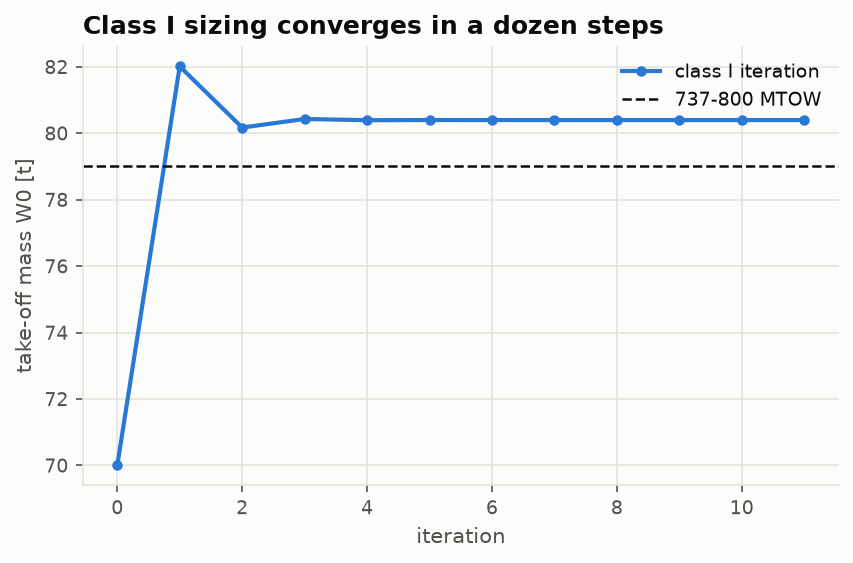
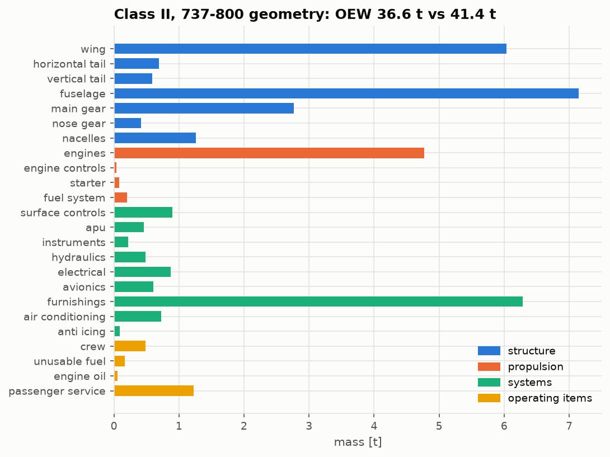

# Lesson 2 · Weight estimation

> *An aircraft must lift its own structure, its fuel and its payload, and the fuel it needs
> depends on how heavy it is. Take-off weight is the fixed point of that loop. Two levels of
> method close it: historical fractions first, then a component-by-component build-up once
> there is a geometry to weigh.*

**Code:** [`src/acdesign/weight_estimation/`](../../src/acdesign/weight_estimation) ·
**Notebook:** [`02_weight_estimation.ipynb`](../../notebooks/02_weight_estimation.ipynb) ·
**Previous:** [Lesson 1](01-requirements-and-reference.md) ·
**Next:** [Lesson 3 — The constraint diagram](03-constraint-diagram.md)

## Learning objectives

1. Write the weight equation and solve it by fixed-point iteration.
2. Build the mission fuel fraction from segment fractions and the Breguet equations.
3. Explain the weight snowball and compute a growth factor.
4. Apply a class II component build-up, and know where a statistical method stops being
   valid.

---

## 1. The weight equation

Split the take-off mass $W_0$ into crew and payload (given), fuel and empty mass (fractions of
$W_0$):

```math
W_0 = \frac{W_{\text{crew}} + W_{\text{payload}}}{1 - W_f/W_0 - W_e/W_0}
```

The empty fraction falls slowly with size. Raymer's regression for jet transports is
$W_e/W_0 = 1.02 W_0^{-0.06}$ with $W_0$ in pounds. That makes the right-hand side depend
on $W_0$, so it is solved by iteration from a guess. It converges in a dozen steps
([`class_one.py`](../../src/acdesign/weight_estimation/class_one.py)).

## 2. Mission fuel by segments

The mission is a chain of segments. Each ends at a weight $W_i = f_i W_{i-1}$:

| Segment | Fraction | Source |
|---|---|---|
| warm-up and take-off | 0.970 | Raymer, historical |
| climb | 0.985 | Raymer, historical |
| cruise | $\exp(-R c/(V L/D))$ | Breguet range equation |
| descent and landing | 0.995 | Raymer, historical |
| diversion | climb · cruise · landing | as above |
| hold | $\exp(-E c/(L/D))$ | Breguet endurance equation |

Here $c$ = TSFC · $g_0$, in 1/s. The Breguet range equation follows from
$dW/dt = -c T = -c W/(L/D)$ at constant V and L/D:

```math
R = \frac{V}{c}\,\frac{L}{D}\,\ln\frac{W_{\text{start}}}{W_{\text{end}}}
```

The **range factor** $(V/c)(L/D)$ measures a whole airframe–engine combination in one
number. Take V = 231.3 m/s (Mach 0.78 at FL350), TSFC 17.12 mg/(N·s) (AERO-03's CFM56-7B26/3
at FL350) and L/D = 16.5. The range factor is 22,700 km, and the 2,800 nmi cruise burns
20.4 % of the cruise-start weight.

Class I needs an L/D before the aircraft has a shape. Raymer's wetted-aspect-ratio
correlation provides one:

```math
\left(\tfrac{L}{D}\right)_{\max} = 15.5\sqrt{\frac{A}{S_{\text{wet}}/S_{\text{ref}}}},
\qquad \left(\tfrac{L}{D}\right)_{\text{cruise}} = 0.866\left(\tfrac{L}{D}\right)_{\max}
```

For jets, the best range comes at $\sqrt3/2$ of the maximum L/D.

## 3. Class I for the design mission

With the 737-800's wetted area ratio, 6.22, the correlation gives (L/D)max = 19.1. Add
AERO-03's cruise TSFC and the reserves of Lesson 1. Class I then sizes the design mission
to **80.4 t, 1.8 % above the 737-800's MTOW**.



The close match is partly luck. The correlation's 15.5 is a historical average, and the
engine is uninstalled: no bleed, no power offtake. Treat it as a first estimate.

### The snowball

Add 1 kg of payload and $W_0$ grows by more than 1 kg: structure to carry it, fuel to fly it,
structure to carry that fuel. Differentiating the weight equation gives the growth factor:

```math
\frac{\partial W_0}{\partial W_p} = \frac{1}{1 - W_f/W_0 - (1 + C)\,W_e/W_0}
= \frac{1}{1 - 0.297 - 0.94 \times 0.494} = 4.2
```

The full class II sizing of Lesson 4 gives 2.2. Class II component masses grow more slowly
than $W_0$; Raymer's wing goes as $W^{0.557}$, for example. The class I regression mixes
aircraft of every size and so overstates the snowball. Both numbers explain why a 5 % better
L/D, or a 5 % better TSFC, takes 3.8 % off $W_0$ in class I.

## 4. Class II: weighing the components

Once wing, tails, fuselage, gear and engines have sizes, each gets its own statistical
equation. [`class_two.py`](../../src/acdesign/weight_estimation/class_two.py) combines two
published methods:

- **Raymer's cargo/transport equations** (ch. 15) for structure and propulsion. Example, the
  wing:
  $W = 0.0051 (W_{dg}N_z)^{0.557} S_w^{0.649} A^{0.5} (t/c)^{-0.4} (1+\lambda)^{0.1} (\cos\Lambda)^{-1} S_{csw}^{0.1}$,
  in pounds, square feet and the ultimate load factor.
- **FLOPS** (NASA/TM-2017-219627) for systems, furnishings and operating items.

Why two methods? Raymer's transport equations were fitted largely to military transports.
His furnishings equation gives **1,444 lb** for the 737's cabin. FLOPS counts seats by class,
galleys, lavatories and linings, and gives **13,865 lb**. A commercial cabin is not a cargo
hold.

All equations are imperial. `ClassTwoInputs` is SI and every equation converts at its
boundary with the exact factors of [`units.py`](../../src/acdesign/units.py). A test doubles
$W_{dg}$ and checks that the wing grows by exactly $2^{0.557}$, so no exponent is lost in
the wrapping.

### The 737-800 check

Run on the published 737-800 geometry at MTOW, with no input tuned:

| Group | Mass [kg] |
|---|---|
| structure | 18,905 |
| propulsion | 5,092 |
| systems (incl. furnishings 6,289) | 10,644 |
| operating items | 1,935 |
| **OEW** | **36,576**, vs 41,413 published: **−11.7 %** |



An 11.7 % shortfall is inside the ±15 % that conceptual statistical methods are trusted to,
but it is not small. It was left uncalibrated on purpose. Lesson 4 shows how it propagates,
and Lesson 5 checks the largest single item, the wing, independently.

## 5. Common pitfalls

- **Fractions without units.** Raymer's regressions take pounds. Feeding them kilograms
  shifts $W_e/W_0$ by $2.2^{-0.06}$, a silent 5 %.
- **Double-counting reserves.** Raymer's quick method multiplies fuel by 1.06 for reserves
  and trapped fuel. Do that *or* model reserves explicitly, as here, never both.
- **Trusting a method outside its population.** Military-transport furnishings in an
  airliner, as above.

## 6. Exercises

1. Show that the Breguet cruise fraction for 2,800 nmi at L/D 16.5, V = 231.3 m/s,
   TSFC 17.12 mg/(N·s) is 0.796.
2. Derive the growth factor of §3 from the weight equation.
3. If the empty fraction were constant ($C = 0$), what would the class I growth factor be?
4. Why does the class II sizing have a smaller snowball than class I?

<details>
<summary>Answers</summary>

1. $c$ = 17.12e-6 × 9.80665 = 1.679e-4 1/s. Then
   $R c / (V L/D)$ = 5.186e6 × 1.679e-4 / (231.3 × 16.5) = 0.228, and $e^{-0.228}$ = 0.796.
2. Write $W_0(1 - f_f) - W_e(W_0) = W_p + W_c$. Differentiate:
   $\partial W_0 (1 - f_f - dW_e/dW_0) = \partial W_p$, with
   $dW_e/dW_0 = (1 + C) W_e/W_0$.
3. 1/(1 − 0.297 − 0.494) = 4.8.
4. Most class II components scale with a power of $W_0$ below one: wing 0.557, fuselage
   0.5, gear 0.89. Furnishings, avionics and crew do not scale with it at all.

</details>

## Key takeaways

- $W_0$ is the fixed point of a weight equation. Fuel comes from segment fractions and
  Breguet.
- The growth factor (2–4 for a transport) multiplies every error and every improvement.
- A class II build-up needs the right statistical population. Here an uncalibrated mix of
  Raymer and FLOPS puts the 737-800's OEW 11.7 % low.

## Further reading

- D. P. Raymer, *Aircraft Design: A Conceptual Approach*, ch. 3 and 15.
- D. P. Wells, B. L. Horvath & L. A. McCullers, *The Flight Optimization System Weights
  Estimation Method*, NASA/TM-2017-219627 (2017).
- E. Torenbeek, *Synthesis of Subsonic Airplane Design*, ch. 8.
