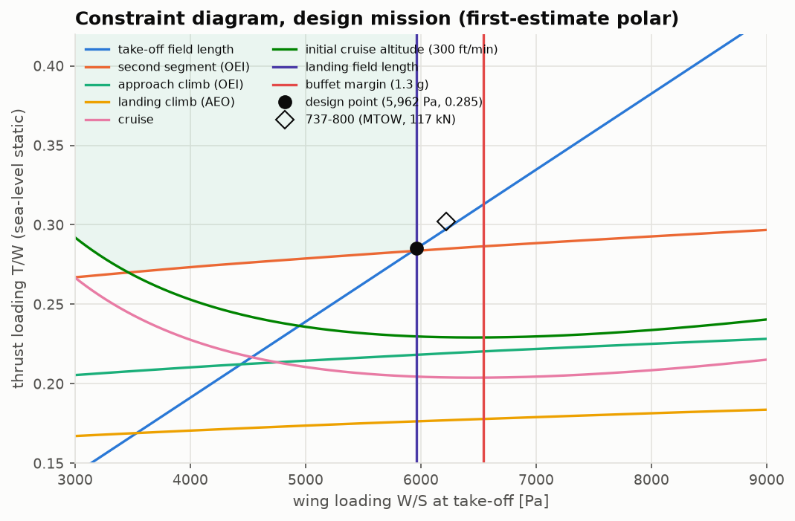

# Lesson 3 · The constraint diagram

> *Two numbers set the size of the wing and of the engines relative to the weight: wing
> loading W/S and thrust loading T/W. Every performance requirement draws a line in the
> (W/S, T/W) plane; the aircraft must sit above all of them and left of the field limits.*

**Code:** [`src/acdesign/constraint_analysis/`](../../src/acdesign/constraint_analysis) ·
**Notebook:** [`03_constraint_diagram.ipynb`](../../notebooks/03_constraint_diagram.ipynb) ·
**Previous:** [Lesson 2](02-weight-estimation.md) ·
**Next:** [Lesson 4 — Wing and tail sizing](04-wing-and-tail-sizing.md)

## Learning objectives

1. Turn field-length, climb and cruise requirements into T/W(W/S) curves.
2. Derive the master equation and its special cases.
3. Use the engine's thrust lapse to refer every requirement to sea-level-static thrust.
4. Read the feasible region and choose a design point.

---

## 1. One basis for every requirement

Requirements apply at different weights and speeds, but they are drawn on one diagram. The
basis is **sea-level-static rated thrust over take-off weight**. A requirement met at weight
$\beta W_{TO}$ with available thrust $\alpha T_{SL}$ becomes (Mattingly's master equation):

```math
\frac{T_{SL}}{W_{TO}} = \frac{\beta}{\alpha}\left[\frac{q}{\beta\,W/S}\left(C_{D_0}
+ K\left(\frac{n\beta\,W/S}{q}\right)^2\right) + \frac{P_s}{V}\right]
```

Here $K = 1/(\pi A e)$, n is the load factor and $P_s$ the specific excess power. The thrust
lapse α comes from the AERO-03 engine at the flight condition and rating
([`engine.py`](../../src/acdesign/external/engine.py)): 0.249 at FL350 and Mach 0.78 at the
climb rating, 0.83 at Mach 0.2 on the runway.

Two special cases are worth knowing:
- In level flight ($P_s = 0$, $n = 1$, $\alpha = \beta = 1$), T/W has a minimum of
  1/(L/D)max, at $W/S = q\sqrt{C_{D_0}/K}$. The tests check this numerically.
- For a climb gradient G, $P_s/V = G$. At a fixed CL, the requirement does not depend on
  W/S.

## 2. The requirements

| Requirement | Equation | Configuration (assumptions) |
|---|---|---|
| take-off field length | $s_{TO}$ [ft] = 37.5 (W/S)/(σ CLmax,TO T/W), W/S in lb/ft² (Loftin) | CLmax,TO = 2.1 |
| landing field length | $s_L$ [ft] = 0.3 $V_A^2$ [kt], $V_A = 1.3 V_s$ (Loftin) → max W/S | CLmax,L = 2.7, MLW/MTOW 0.84 |
| second segment, OEI (FAR 25.121b) | $T/W = \frac{N}{N-1}\frac{\beta}{\alpha}(1/(L/D) + 0.024)$ | take-off flaps, gear up, $V_2 = 1.2V_s$ |
| approach climb, OEI (25.121d) | same, G = 0.021, at landing weight | approach flaps, 1.3 $V_s$ |
| landing climb, AEO (25.119) | G = 0.032, all engines | landing flaps, gear down |
| cruise | master equation, $P_s = 0$ | Mach 0.78, FL350, β = 0.955 |
| initial cruise altitude | master equation, $P_s$ = 300 ft/min | same |
| buffet margin | 1.3 g to buffet onset → max W/S | $C_{L,\text{buffet}}$ = 0.80 |

Loftin's field-length correlations (NASA RP-1060) are statistical. The landing one is equivalent to
$m/S = 0.107 \sigma C_{L_{\max}} s_L$ in kg/m² and m. The test checks that identity.

**A deduction from the reference.** Put the 737-800's published numbers into Loftin's
take-off line: W/S at MTOW, two 26,000 lbf engines, and 7,800 ft. The line implies
CLmax,TO = **2.09**. The assumed 2.1 is consistent with that, but it was chosen as
"typical of slats with double-slotted flaps", not fitted.

## 3. The diagram



Use the first-estimate polar ($C_{D_0}$ = 0.0026 · 6.21 = 0.0161, Raymer's e = 0.771):

- the landing field length caps W/S at **5,962 Pa**;
- at that wing loading the take-off field length needs T/W = **0.285**;
- the second-segment climb needs 0.284, nearly the same;
- cruise and initial cruise altitude need only 0.205 and 0.230. A field-limited twin has
  plenty of thrust at altitude.

The 737-800 sits at 6,219 Pa and 0.302. The design point is 4 % and 6 % below it.

## 4. Choosing the design point

"The least T/W in the feasible region" sounds natural, but it fails here. The
one-engine-out lines are almost flat in W/S: their T/W falls slowly at low W/S, because V2
is lower and the engine lapses less. Their minimum would put the design at 3,500 Pa, with a
wing nearly twice the size.

Transports are sized the other way round. Take the **highest W/S the field allows**
(smallest wing), then the **least T/W meeting every line there** (smallest engines).
Lesson 7's carpet plot re-sizes the whole aircraft over a W/S × T/W grid and confirms this
point is the lightest feasible one.

## 5. Common pitfalls

- **Forgetting the lapse.** A cruise requirement in cruise thrust looks tiny. On a
  sea-level-static basis it is four times larger (α ≈ 0.25).
- **Mixing weights.** Landing W/S must be referred to take-off W/S through MLW/MTOW.
- **Reading CLmax as a free parameter.** It decides both field lines. Say where it comes
  from, and check it against the reference, as in §2.

## 6. Exercises

1. Show that level-flight T/W is minimum at $W/S = q\sqrt{C_{D_0}/K}$, and that the minimum
   equals $2\sqrt{C_{D_0} K}$.
2. Derive the factor 0.107 from Loftin's $s_L$ = 0.3 $V_A^2$ (ft, kt) and $V_A = 1.3V_s$.
3. Why does a twin need more thrust for a one-engine-out climb than a four-engine aircraft
   at the same L/D?
4. Using §2, what landing CLmax would let the design reach the 737's 6,219 Pa?

<details>
<summary>Answers</summary>

1. $T/W = qC_{D_0}/w + Kw/q$ with $w = W/S$. Setting $d(T/W)/dw = 0$ gives
   $w^2 = q^2 C_{D_0}/K$. Substituting back gives $2\sqrt{C_{D_0}K}$ = 1/(L/D)max.
2. $s$ [ft] = 0.3 (1.3 $V_s$/0.5144)², with $V_s$ in m/s. That is 1.916 $V_s^2$ ft, or
   0.584 $V_s^2$ m. With $V_s^2 = 2(m/S)g/(\rho_0\sigma C_{L_{\max}})$:
   m/S = s ρ₀ σ CLmax/(0.584 × 2 × 9.807) = 0.107 σ CLmax s.
3. N/(N−1) = 2 for a twin against 4/3 for a quad: the twin loses half its thrust.
4. W/S scales with CLmax: 2.7 × 6,219/5,962 = 2.82. That is the value Lesson 1's landing
   chart implies for the 737-800.

</details>

## Key takeaways

- One basis, rated sea-level-static thrust over take-off weight, puts every requirement on
  one diagram. Lapse and weight fractions do the bookkeeping.
- For a short-field twin, the field lengths and the one-engine-out climb set the design.
  Cruise does not.
- Choose the highest feasible W/S, then the least T/W there. Check it against least weight.

## Further reading

- J. D. Mattingly, W. H. Heiser & D. T. Pratt, *Aircraft Engine Design*, ch. 2.
- L. K. Loftin, *Subsonic Aircraft: Evolution and the Matching of Size to Performance*,
  NASA RP-1060 (1980).
- D. P. Raymer, *Aircraft Design*, ch. 5 and 17; FAR 25.119 and 25.121.
