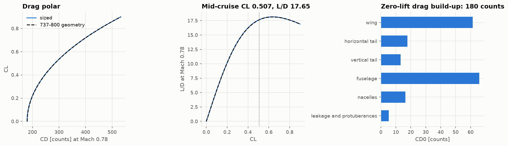
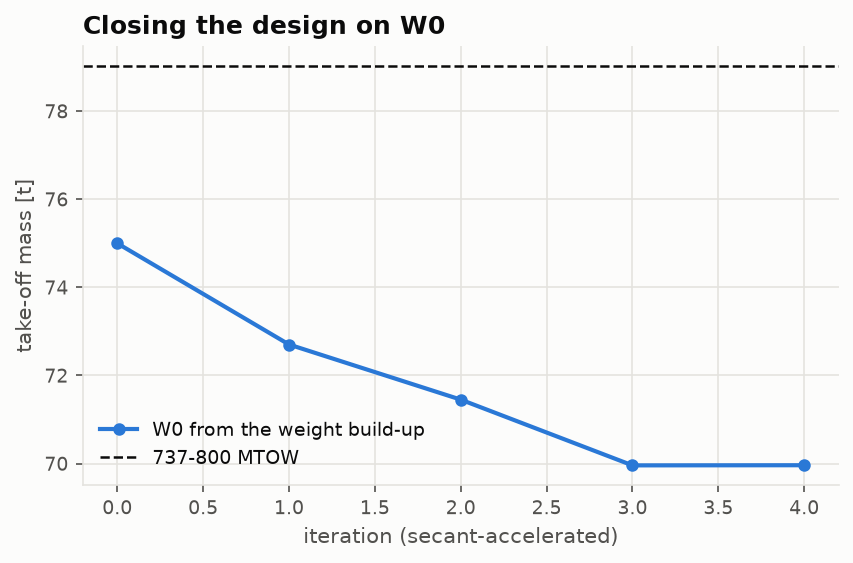
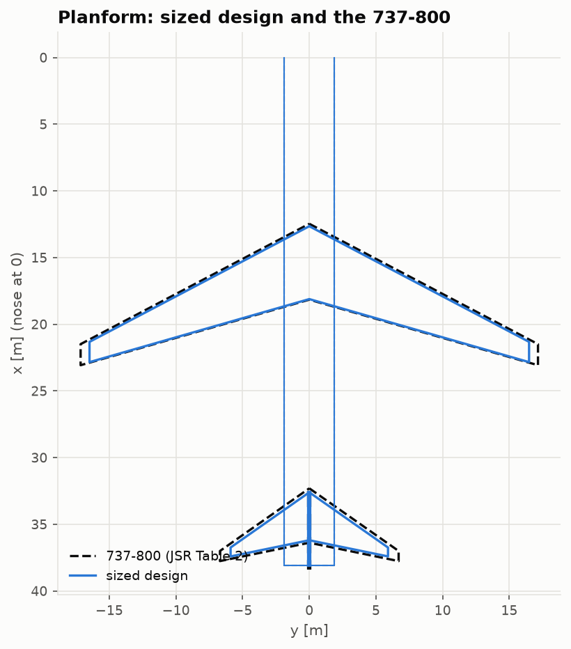

# Lesson 4 · Wing and tail sizing, and closing the design

> *The design point gives W/S and T/W; the weight gives W0. Together they give a wing area and
> an engine size — and then the wing's drag changes the fuel, the fuel changes W0, and W0
> changes the wing. This lesson builds the geometry and the aerodynamics, and closes the
> loop.*

**Code:** [`src/acdesign/sizing.py`](../../src/acdesign/sizing.py),
[`src/acdesign/wing_tail_sizing/`](../../src/acdesign/wing_tail_sizing),
[`src/acdesign/external/wing_aero.py`](../../src/acdesign/external/wing_aero.py) ·
**Notebook:** [`04_wing_and_tail_sizing.ipynb`](../../notebooks/04_wing_and_tail_sizing.ipynb) ·
**Previous:** [Lesson 3](03-constraint-diagram.md) ·
**Next:** [Lesson 5 — Structural sizing check](05-structural-sizing-check.md)

## Learning objectives

1. Lay out a trapezoidal wing from S, A, λ and Λ, and size tails by volume coefficients.
2. Get a compressible lift slope and a span efficiency from a vortex lattice (AERO-01).
3. Build a drag polar component by component, with wave drag.
4. Close every discipline on W0, and read what the closed design says.

---

## 1. Planform and tails

Given S = W0 g/(W/S), aspect ratio A, taper λ and quarter-chord sweep Λ:

```math
b = \sqrt{AS},\quad c_r = \frac{2S}{b(1+\lambda)},\quad
\bar c = \tfrac23 c_r\frac{1+\lambda+\lambda^2}{1+\lambda},\quad
y_{\bar c} = \frac b6\frac{1+2\lambda}{1+\lambda}
```

([`Planform`](../../src/acdesign/external/wing_aero.py)). The baseline planform takes the
737-800's A = 9.44, λ = 0.278, Λ = 25°, so that the comparison isolates the *sizing*.

Tails are sized by **volume coefficients**, $V_H = S_H l_H/(S\bar c)$ and
$V_V = S_V l_V/(S b)$. Raymer's typical values for jet transports are 1.00 and 0.09. The
737-800 has 1.10 and 0.096 (Jenkinson). The tail arm is the 737's own fraction of the
fuselage length (0.464); the fuselage itself is fixed by the cabin of Lesson 1.

## 2. Lift slope by the Göthert rule

The AERO-01 vortex lattice is incompressible. The **Prandtl–Glauert–Göthert rule** maps a
wing in subsonic compressible flow onto an incompressible one stretched in x by $1/\beta$,
with $\beta = \sqrt{1-M^2}$. The stretched wing has aspect ratio $\beta A$ and
$\tan\Lambda' = \tan\Lambda/\beta$, and

```math
C_{L_\alpha}(M) = \frac{C_{L_\alpha,\text{inc}}(\text{stretched wing})}{\beta}
```

The DATCOM/Helmbold formula is built the same way. For the 737 planform the VLM gives
6.23 per rad at Mach 0.78 against DATCOM's 6.36, within the 4 % the tests allow for tapered
planforms. For untapered wings DATCOM is 7 % high, a limit of the fit, not of the lattice.

The lattice also gives the **inviscid span efficiency**, 0.995 for this planform (Trefftz
plane), and, through Biot–Savart, the **downwash at the tail**. Here a detail matters:
induced velocity evaluated exactly on a trailing-vortex node is the classic discrete-vortex
error and halves the answer. The lattice therefore uses an odd number of spanwise strips, so
the symmetry plane, where the tail sits, is a strip centre. The far-wake check against the
elliptic $\varepsilon = 2C_L/(\pi A)$ then holds to within 3 %, and to AERO-01's own Trefftz
plane to 1e-5.

## 3. The drag polar

Zero-lift drag is built per component ([`drag.py`](../../src/acdesign/wing_tail_sizing/drag.py)):

```math
C_{D_0} = \sum_c \frac{C_{f,c}\,FF_c\,Q_c\,S_{\text{wet},c}}{S_{\text{ref}}}\;(1 + 3\,\%)
```

- turbulent skin friction $0.455/((\log_{10}Re)^{2.58}(1+0.144M^2)^{0.65})$, capped at the
  roughness cutoff Reynolds number;
- Raymer's form factors and interference factors;
- a 3 % allowance for leakage and protuberances.



At cruise the build-up gives 180 counts: fuselage 66, wing 61, tails 31, nacelles 16,
leakage 5. The Oswald factor combines the VLM span efficiency with the fuselage and the lift
dependence of viscous drag (Kroo): e = 0.810. Wave drag follows Korn's equation for the
drag-divergence Mach number and Lock's fourth-power law above $M_{crit}$. At the cruise CL
of 0.5 it adds less than a count, because $M_{dd}$ ≈ 0.85.

## 4. Closing the loop

[`size_aircraft`](../../src/acdesign/sizing.py) repeats six steps:

1. constraint diagram with the current polar → (W/S, T/W);
2. S = W0 g/(W/S); planform, tails, engine thrust = (T/W) W0 g/2 (rubber engine);
3. VLM, build-up → polar;
4. class II → OEW;
5. mission fuel with the polar's mid-cruise L/D and the engine's TSFC at the thrust that
   holds it;
6. W0 ← OEW + payload + fuel.

A plain fixed point converges at a ratio of about 0.55 per step, which takes 20 iterations.
A secant update on the residual $W_0^{new} - W_0$ takes **four**.



| | sized | 737-800 | |
|---|---|---|---|
| W0 [t] | 70.0 | 79.0 | −11.5 % |
| OEW [t] | 33.7 | 41.4 | −18.7 % |
| mission fuel [t] | 20.0 | 21.3 | −6.1 % |
| wing area [m²] | 115.1 | 124.6 | −7.6 % |
| thrust per engine [kN] | 97.8 | 117 | −16.4 % |
| CD0 [counts] | 180 | 180 (same build-up on its geometry) | |



The aerodynamics agree. The weights do not, for the reason found in Lesson 2: class II puts
the 737's OEW 11.7 % low at its own geometry. Through the snowball, the closed design's
growth factor is 2.2: 1 kg of payload adds 2.2 kg of take-off mass. A lighter empty
aircraft needs less fuel, a smaller wing and smaller engines, so every size comes out
smaller. The chain is internally consistent and
[`test_sizing.py`](../../tests/test_sizing.py) checks every link:

- W0 = OEW + payload + fuel;
- W0 g/S equals the constraint W/S;
- 2T/(W0 g) equals its T/W;
- the tail volumes are as specified.

What it cannot remove is the bias of its weight statistics.

## 5. Common pitfalls

- **Compressibility applied twice.** Göthert stretches the geometry. Do not also divide the
  stretched result by a Prandtl–Glauert factor.
- **Evaluating induced velocity on a vortex filament.** Use an odd strip count, or average
  over the tail span.
- **Declaring convergence on the iterate instead of the residual.** With secant updates the
  iterate can jump. Test $|W_0^{new} - W_0|$.

## 6. Exercises

1. Compute b, $c_r$ and $\bar c$ of a 115.1 m² wing with A = 9.44 and λ = 0.278.
2. With $V_H$ = 1.0, $l_H$ = 17.68 m and the wing of exercise 1, what tail area is needed?
3. The fuselage has twice the wing's wetted area. Why is its parasite drag only slightly
   larger?
4. The sized aircraft is 11.5 % lighter than the 737-800, but its fuel is only 6.1 % less.
   Why?

<details>
<summary>Answers</summary>

1. b = √(9.44 × 115.1) = 32.96 m; $c_r$ = 2 × 115.1/(32.96 × 1.278) = 5.47 m;
   $\bar c$ = (2/3)(5.47)(1 + 0.278 + 0.077)/1.278 = 3.86 m.
2. $S_H$ = 1.0 × 3.86 × 115.1/17.68 = 25.1 m², the sized tail.
3. Its wetted area (390 m²) is twice the wing's (193 m²). Its longer length gives a lower
   $C_f$ (0.00179 against 0.00249), and its form factor (1.08 at fineness 10.2) is lower
   than the wing's (1.48, thickness and Mach). These two effects nearly cancel the area
   advantage: 66 against 61 counts.
4. Fuel is set by weight × range / range factor. The range factor ($V L/D / c$) is almost
   the same as the 737's: same planform, same engine. So fuel scales roughly with the
   average weight, which falls less than W0 because the payload, 16.3 t, is the same.

</details>

## Key takeaways

- The planform follows from S and three shape choices. Tails follow from volume
  coefficients.
- The Göthert rule makes an incompressible VLM give compressible lift slopes. Discretisation
  details (odd strip count) matter for downwash.
- Closing the loop is a fixed-point problem. The closed design is internally consistent, but
  it inherits the bias of its weight statistics, amplified by the growth factor.

## Further reading

- D. P. Raymer, *Aircraft Design*, ch. 4, 6, 7 and 12.
- J. Katz & A. Plotkin, *Low-Speed Aerodynamics*, ch. 12–13.
- B. Malone & W. H. Mason, "Multidisciplinary optimization in aircraft design using
  analytic technology models", *J. Aircraft* 32(2), 1995 (Korn equation).
