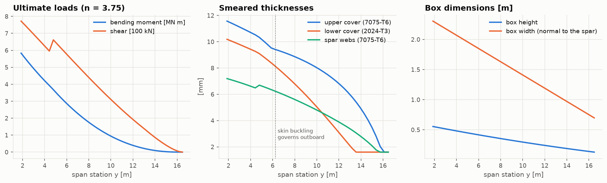

# Lesson 5 · Structural sizing check

> *The class II wing mass is a regression over past aircraft. To trust it for a new wing,
> weigh the wing a second, independent way: size the material it actually needs to carry
> its loads, then account for everything a beam model leaves out.*

**Code:** [`src/acdesign/structural_sizing_check/`](../../src/acdesign/structural_sizing_check),
[`src/acdesign/external/wing_box.py`](../../src/acdesign/external/wing_box.py) ·
**Notebook:** [`05_structural_sizing_check.ipynb`](../../notebooks/05_structural_sizing_check.ipynb) ·
**Previous:** [Lesson 4](04-wing-and-tail-sizing.md) ·
**Next:** [Lesson 6 — Performance and stability](06-performance-and-stability.md)

## Learning objectives

1. Build the ultimate spanwise loads of a wing, with inertia relief.
2. Size a skin-stringer box: covers in compression and tension, spar webs in shear.
3. Use AERO-02's beam solver, sections, buckling and fatigue routines as building blocks.
4. Compare a physics-based mass with a statistical one, and say what the comparison proves.

---

## 1. Loads

The critical case for the wing box is a symmetric pull-up at the **ultimate load factor**:
$n = 1.5 \times 2.5 = 3.75$. That is FAR 25's minimum limit load factor for a transport
this heavy, times the safety factor. The lift per unit span is
$n W g/b$ times the VLM span-loading shape (AERO-01). The wing's own mass, its fuel and its
engines all pull down at n g. This **inertia relief** is why wing fuel and wing-mounted
engines lighten the wing.

Two cases bound the root bending moment:
- take-off mass, with the wing tanks full (37.5 % of the fuel, spread like the chord²);
- zero-fuel mass, with no fuel relief.

The envelope of the two is used.

The box is a cantilever from the side of the body, swept at its mid-chord. Positions along
the structural axis are $s = (y - y_0)/\cos\Lambda$, and loads per unit structural length are
$w(y)\cos\Lambda$. The moment the AERO-02 [`Beam`](../../src/acdesign/external/wing_box.py)
solver returns is then the moment normal to the spar, which is what the covers carry. The
beam is statically determinate, so its stiffness does not enter.

## 2. Sizing the box

At 41 stations the box is the wing between spars at 15 % and 65 % chord, 85 % of the local
thickness deep. Thickness runs from t/c = 0.13 at the root to 0.10 at the tip. The cover
force is the couple $P = M/h$.

- **Upper cover** (7075-T6, compression). Stringers between ribs 0.6 m apart buckle as
  Johnson–Euler columns. With a 18 mm radius of gyration (L/ρ = 33) the allowable is
  **395 MPa**:

  ```math
  \sigma_{J} = F_{cy}\left[1 - \frac{F_{cy}(L/\rho)^2}{4\pi^2E}\right]
  ```

  The skin between stringers must also not buckle below limit load (ultimate/1.5). The
  plate stress is $k\pi^2E/(12(1-\nu^2))(t/b)^2$ with k from AERO-02's `compression_k`.
  Outboard of about 6 m, where the covers get thin, this criterion governs.
- **Lower cover** (2024-T3, tension). The allowable is the smaller of $F_{tu}$ = 448 MPa and
  n times the 1-g stress for 225,000 ground–air–ground cycles on the MIL-HDBK-5J Kt = 2
  curve: 183 MPa × 3.75 = 688 MPa. Fatigue does not bind at Kt = 2 with this simple cycle.
  Real lower covers are fatigue-designed, because fastener holes and the gust spectrum are
  far harsher. That gap is a known limit of the model.
- **Spar webs** carry $q = V/(2h)$ at the smaller of $F_{su}$ and the shear-buckling
  stress, with k from `shear_k`.
- **Minimum gauge**: 1.6 mm everywhere.



The second moment of area of each section comes from AERO-02's `thin_walled` closed box. It
gives the 1-g tip deflection by integrating M/(EI) twice: 0.91 m, or 5.5 % of the semispan.

## 3. Physics against statistics

The ideal box is not the wing. Ribs, joints, fasteners, cut-outs and access panels add a
**non-optimum factor**, taken here as 1.5. Leading and trailing edges, high-lift devices and
control surfaces add **secondary structure**, taken as 15 kg/m² of wing area. Both were
chosen before the comparison:

| | sized design | 737-800 geometry |
|---|---|---|
| ideal box, both wings | 2,334 kg | 2,737 kg |
| × 1.5 + secondary | 5,227 kg | 5,974 kg |
| Raymer class II wing | 5,315 kg | 6,037 kg |
| **physics / statistics** | **0.98** | **0.99** |

Agreement to 2 % between two independent methods is better than either deserves. The
non-optimum factor alone carries ±15 %. The useful conclusion is narrower: the class II wing
is *not* where Lesson 2's 11.7 % OEW shortfall comes from. The search moves to systems and
fuselage.

One modelling choice moved the answer. Without the skin-buckling criterion the physics wing
was 6 % lighter than Raymer's. That criterion is a real design rule, and adding it is
physics, not tuning, but it shows how sensitive such checks are to which failure modes are
modelled.

## 4. Common pitfalls

- **Ignoring sweep.** The covers carry the moment normal to the spar, $M/\cos\Lambda$ in
  effect, over a box narrowed by $\cos\Lambda$. A streamwise analysis underestimates the
  material by up to $1/\cos^2\Lambda$.
- **Forgetting inertia relief, or counting it at 1 g.** Relief scales with n, like the lift.
- **Comparing an ideal box with a whole wing.** Without non-optimum and secondary
  structure, the physics mass is less than half the real one.

## 5. Exercises

1. Show that a uniformly loaded cantilever has root moment $wL^2/2$, and use the AERO-02
   beam to check it (the adapter's test does).
2. At the root (M = 5.83 MN m ultimate, h = 0.55 m, box width 2.30 m), what smeared upper
   cover thickness is needed at 395 MPa?
3. Why does the zero-fuel case often set the root bending moment of an airliner wing?
4. What would make fatigue, not $F_{tu}$, govern the lower cover?

<details>
<summary>Answers</summary>

1. Shear $V(x) = w(L - x)$, moment $M(x) = w(L-x)^2/2$, so $M(0) = wL^2/2$.
   `tests/test_wing_box_adapter.py` checks this, with a point load added.
2. P = 5.83e6/0.554 = 10.5 MN; t = P/(w σ) = 10.5e6/(2.30 × 395e6) = 11.6 mm, which is
   the plotted root value.
3. Lift is the same at the same total weight, but without fuel in the wing there is less
   relief. At MZFW the wing carries almost the whole aircraft's weight with only its own
   structure and engines relieving it.
4. A higher stress concentration (Kt = 3–4 at fastener holes), a gust and manoeuvre
   spectrum instead of one cycle per flight, and a longer life: each pushes the allowable
   1-g stress below $F_{tu}/n$.

</details>

## Key takeaways

- Ultimate loads come from n times weight, less n times the relieving masses.
- A skin-stringer box is sized by column, skin-buckling, tension and shear allowables. Each
  governs somewhere along the span.
- Two independent wing masses agree within 2 %, which validates the wing equation, not the
  whole empty weight.

## Further reading

- T. H. G. Megson, *Aircraft Structures for Engineering Students*, ch. 8–9 and 21.
- E. F. Bruhn, *Analysis and Design of Flight Vehicle Structures*, ch. C1–C7.
- E. Torenbeek, *Synthesis of Subsonic Airplane Design*, ch. 8 and app. C (wing weight).
- MIL-HDBK-5J (via AERO-02's material and S-N data).
