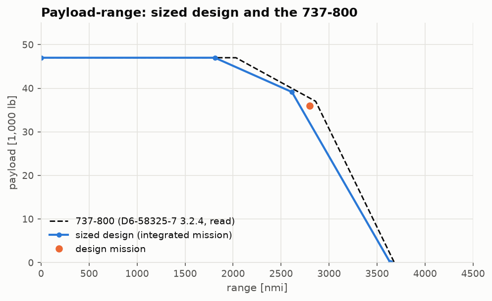
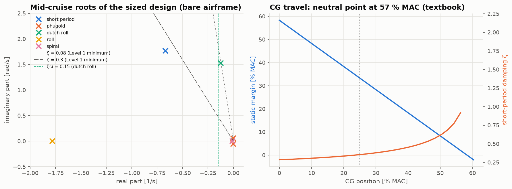

# Lesson 6 · Performance and stability verification

> *A sized aircraft is a hypothesis. Fly it through its mission with a better model than
> the one that sized it, and check that it is stable and pleasant to fly. Where it falls
> short, the shortfall is a design finding, not an error to hide.*

**Code:** [`src/acdesign/performance_verification/`](../../src/acdesign/performance_verification),
[`src/acdesign/external/stability.py`](../../src/acdesign/external/stability.py) ·
**Notebook:** [`06_performance_and_stability.ipynb`](../../notebooks/06_performance_and_stability.ipynb) ·
**Previous:** [Lesson 5](05-structural-sizing-check.md) ·
**Next:** [Lesson 7 — Trade studies](07-trade-studies.md)

## Learning objectives

1. Integrate a mission profile with an engine model instead of Breguet fractions.
2. Draw a payload-range diagram and check that the fuel fits.
3. Place the wing for balance, find the neutral point, and estimate a full set of stability
   derivatives from geometry.
4. Judge the modes against MIL-F-8785C, and read a failed requirement correctly.

---

## 1. Flying the mission

[`mission.py`](../../src/acdesign/performance_verification/mission.py) integrates the flight
in time:

- **Climb** at 290 kt CAS up to the Mach 0.78 crossover, then at Mach 0.78, at the AERO-03
  engine's climb rating. The energy equation gives the rate of climb,
  $(T-D)V/W = \dot h (1 + (V/g) dV/dh)$, and the engine model gives fuel flow and distance.
- **Cruise** at Mach 0.78 and FL350, where thrust equals the drag of the current weight.
  Fuel flow is TSFC(thrust) × thrust from the part-power line, integrated over weight with
  Simpson's rule.
- **Descent** on a 3° path. Its distance is credited; its fuel is Raymer's 0.995.

Flown with the fuel the sizing put on board, holding back the same reserves:

| segment | distance | fuel | time |
|---|---|---|---|
| take-off | — | 2,099 kg | — |
| climb | 156 nmi | 1,586 kg | 24 min |
| cruise | 2,676 nmi | 12,274 kg | 357 min |
| descent | 110 nmi | 270 kg | 28 min |
| reserves (held) | | 3,543 kg | |
| **total** | **2,943 nmi** | 19,972 kg | |

That is 5.1 % more than the 2,800 nmi requirement. The Breguet sizing was conservative:
Raymer's climb and descent fractions count fuel but no distance, while the integration
credits 266 nmi for them. A test keeps the integrated range above the requirement, by less
than the climb-and-descent distance.

### Payload-range and fuel volume

With the 737-800's maximum payload (same fuselage) and its tanks scaled by $S^{1.5}$, the
sized design's diagram runs just inside the 737's. The corners fall at 1,810, 2,613 and
3,637 nmi, against 2,030, 2,860 and 3,680.

One check fails. The design fuel is **108 %** of that scaled capacity, 1,800 L too much. The
landing-limited wing is smaller than the 737's and holds less fuel. The fix is a design
decision, such as a larger centre tank or a larger wing, which is exactly the kind of
finding verification is for.

## 2. Balance and the neutral point

The class II component masses are placed along the fuselage:

- fixed items by fractions of its length, and the cabin items at the cabin centroid;
- the wing group (wing, fuel, main gear, engines, tails) with the wing.

The wing is then slid until the mid-cruise CG sits at **25 % MAC**, a design choice. The
empty CG lands at 22 %.

The neutral point needs three aerodynamic quantities:

- **wing aerodynamic centre**: from the VLM's moment at Mach 0.78 (Göthert), **31.5 % MAC**,
  aft of the quarter chord as expected for a swept wing at high subsonic Mach;
- **fuselage**: Torenbeek's shift, $-1.8 b_f h_f l_{fn}/(S\bar c C_{L_\alpha})$, moves the
  wing-body aerodynamic centre forward to **19.5 %**;
- **tail**: its own VLM lift slope (5.08 per rad), η = 0.9, and the VLM downwash gradient
  at the tail, **0.43**.

The textbook formula then puts the stick-fixed neutral point at **56.8 % MAC**. Separately,
the derivatives are assembled into an AERO-04 `Aircraft`, and its `neutral_point_shift`
gives a static margin of **33.3 %** at the 25 % CG. The textbook value is 31.8 %. The two
differ only in where the tail arm is measured from, the CG or the wing-body aerodynamic
centre. AERO-04's `move_cg` by exactly that margin brings the neutral-point shift to zero
(to 1e-9), a test of the whole chain.

## 3. A full derivative set from geometry

AERO-04 needs 21 derivatives and has no geometry-to-derivative estimator. They are built in
[`stability.py`](../../src/acdesign/performance_verification/stability.py):

- **tail terms**: AERO-04's own `HorizontalTail.contributions()` (Etkin & Reid) gives the
  tail's share of $C_{L_\alpha}$, $C_{m_\alpha}$, $C_{m_q}$, $C_{m_{\dot\alpha}}$ and
  $C_{m_{\delta_e}}$;
- **wing rolling derivatives**: from the AERO-01 lattice with sideslip, roll rate, yaw rate
  and antisymmetric aileron incidence in the boundary condition, by central differences of
  a linear system. These are $C_{l_\beta}$ = −0.18 (sweep plus 6° dihedral), $C_{l_p}$ = −0.62
  and $C_{l_r}$ = +0.14. Their signs follow Etkin & Reid, and $C_{l_p}$ tends to the strip-theory
  value −2π/6 as A → ∞;
- **fin**: its VLM lift slope at an end-plate-corrected aspect ratio, the DATCOM sidewash
  fit, and the classical tail-arm formulas for every lateral derivative;
- **fuselage**: Raymer's $C_{n_\beta}$.

## 4. Modes and flying qualities

Trim, `linearize` and the modal analysis of AERO-04 at mid-cruise give:

| requirement (MIL-F-8785C Level 1, Class III, Cat. B) | value | |
|---|---|---|
| short-period damping 0.30–2.00 | 0.355 | met |
| phugoid damping ≥ 0.04 | 0.035 | not met |
| dutch-roll damping ≥ 0.08 | 0.081 | met |
| dutch-roll ζω ≥ 0.15 rad/s | 0.125 | not met |
| dutch-roll frequency ≥ 0.4 rad/s | 1.53 | met |
| roll time constant ≤ 1.4 s | 0.56 | met |
| spiral: time to double ≥ 20 s | stable | met |

The two misses are typical of what the requirements are written for:

- **Phugoid.** Lanchester's approximation gives $\zeta \approx 1/(\sqrt2 L/D)$, which is
  0.040 at L/D 17.6. An efficient airliner has a lightly damped phugoid by nature, so this
  falls to Level 2 without an autopilot.
- **Dutch roll.** A swept-wing transport's bare-airframe dutch roll is lightly damped at
  altitude, which is why every swept-wing airliner carries a **yaw damper**. The sized
  design needs one too.

## 5. Common pitfalls

- **Comparing a margin defined about one point with a neutral point from another
  formula.** Fix the reference first: about the CG or about the aerodynamic centre.
- **Wrong-sign lateral derivatives.** Lattice axes (x aft, z up) and body axes (x forward,
  z down) differ by a rotation. Check signs on cases with known answers, like the dihedral
  effect and roll damping.
- **Reading a failed flying-quality requirement as a model error.** Here it is the physics,
  and the remedy is augmentation.

## 6. Exercises

1. Show that a jet's best-range Breguet sizing that ignores climb and descent distance is
   conservative.
2. With L/D = 17.6, estimate the phugoid damping from Lanchester's approximation.
3. The empty CG is at 22 % MAC and the loaded mid-cruise CG at 25 %. Which way does it move
   as fuel burns, and why?
4. Why does $C_{l_\beta}$ grow with CL for a swept wing?

Answers

1. Raymer's fractions charge climb and descent fuel but credit them no distance. Real climbs
   cover 150–250 nmi and descents about 100 nmi, so the actual range is longer.
2. $\zeta$ ≈ 1/(1.414 × 17.6) = 0.040. AERO-04's full model gives 0.035.
3. Fuel sits at 40 % MAC, aft of the CG, so burning it moves the CG forward, toward the
   payload-dominated forward position.
4. In sideslip the upwind wing sees less sweep. Its effective normal velocity, and so its
   lift, grows in proportion to the lift already being carried, which rolls the aircraft
   away from the sideslip.

## Key takeaways

- Verify with a better model than the one that sized the design. Here, time integration
  with the engine model gives 5 % more range than the Breguet sizing.
- A 33 % static margin from AERO-04 matches the textbook neutral point to 1.5 % of MAC.
  The whole geometry-to-derivative chain holds together.
- The misses (fuel volume, phugoid, dutch roll) are real design findings, each with a known
  remedy.

## Further reading

- B. Etkin & L. D. Reid, *Dynamics of Flight*, ch. 2, 5 and 6.
- R. C. Nelson, *Flight Stability and Automatic Control*, ch. 2–5.
- MIL-F-8785C, *Flying Qualities of Piloted Airplanes* (1980), §3.2–3.3.
- E. Torenbeek, *Synthesis of Subsonic Airplane Design*, app. E.
