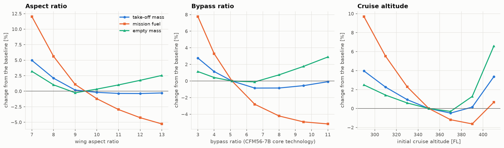
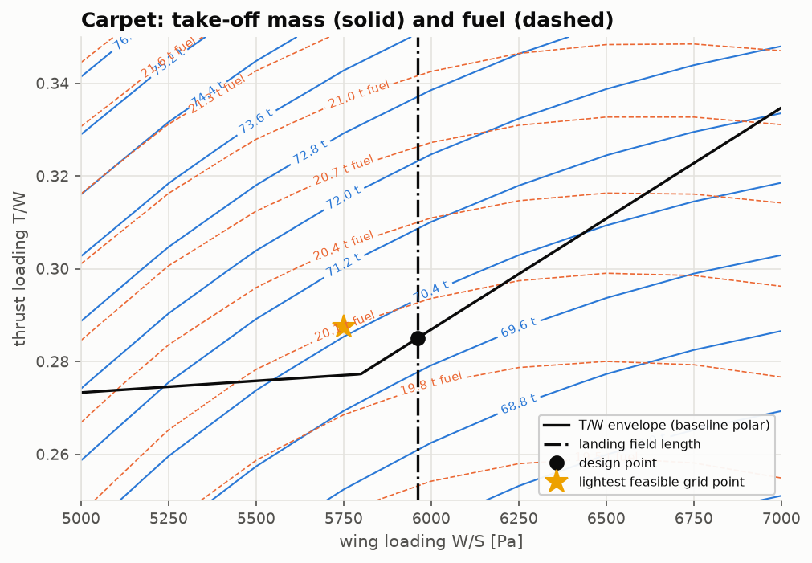

# Lesson 7 · Trade studies

> *A point design answers one question. Trade studies answer the next ones: what if the
> wing were more slender, the engine's bypass ratio higher, the cruise higher? Every point of
> a trade must be a re-sized aircraft, or the curve shows a design that could not exist.*

**Code:** [`src/acdesign/trade_studies/`](../../src/acdesign/trade_studies) ·
**Notebook:** [`07_trade_studies.ipynb`](../../notebooks/07_trade_studies.ipynb) ·
**Previous:** [Lesson 6](06-performance-and-stability.md) ·
**Next:** [Lesson 8 — Verification and validation](08-verification-and-validation.md)

## Learning objectives

1. Run a trade with the whole sizing loop at every point, and say why that matters.
2. Read the classical aspect-ratio, bypass-ratio and altitude trades, and identify which
   constraint shapes each.
3. Build a carpet plot and use it to test the design-point rule of Lesson 3.
4. Separate what a trade predicts robustly (trends, optima) from what it does not (absolute
   values).

---

## 1. Re-size at every point

Make a wing more slender without re-sizing and its L/D rises; the curve shows a pure gain.
Re-size, and the heavier wing needs more lift, the extra weight needs more fuel, and the
engines grow. [`sweep`](../../src/acdesign/trade_studies/studies.py) calls `size_aircraft`
for every value. Each point closes its own constraint diagram, geometry, polar, class II
weights and mission fuel, about 0.1 s each once the engine tables are cached. The 104
sizings of this lesson take under a minute.

## 2. Aspect ratio

From A = 7 to 13, at fixed taper and sweep:

- mission **fuel falls monotonically**, 22.4 t to 18.9 t, as the cruise L/D rises from
  16.1 to 19.1;
- the **empty mass** has a shallow minimum near A = 9 and then rises, with Raymer's wing
  growing as $A^{0.5}$;
- **take-off mass is flat between A = 10 and 13**, within 0.2 %. Its minimum, 69.7 t, is
  near A = 12.

Below A = 9 the binding constraint changes. The one-engine-out second-segment climb, which
depends on low-speed L/D, takes over from the take-off field length, and the engines grow
fast: 117 kN at A = 7 against 98 kN at the baseline. The constraint diagram does not only
size the aircraft; it changes which physics a trade is about.

## 3. Bypass ratio

Rubber engines with the CFM56-7B26/3's core technology run from BPR 3 to 11. They share its
calibrated Tt4 and OPR, use a best-TSFC fan, and grow their nacelle with airflow. Mass at
equal thrust follows the trend fitted to the two TCDS engines: the LEAP-1B is 3 % heavier at
equal thrust. Raymer's statistical term has the opposite sign because it spans older
engine generations.

- Cruise TSFC falls from 18.7 to 15.3 mg/(N·s), so **fuel falls**, 21.5 t to 18.9 t, with
  diminishing returns.
- The engines get heavier and draggier, and they **lapse faster**: thrust at altitude falls
  as bypass ratio rises.
- From BPR 6.5 the one-engine-out climb sets the thrust and the engines grow again. **W0 is
  least at BPR 6.5–8.**

The two calibrated engines of AERO-03, not rubber versions, give a sharper comparison. The
LEAP-1B28 burns **8.2 % less mission fuel** than the CFM56-7B26/3 on the same mission. Its
cruise TSFC is 11 % lower, and part of that is spent carrying a heavier, larger engine.

## 4. Cruise altitude

Between FL290 and FL390, higher is better: fuel falls 10 %, as the cruise CL approaches
best L/D and the engine works at a better TSFC. Above **FL370 the 1.3 g buffet margin**
starts to limit the wing loading. The constraint diagram's buffet line moves left as q
falls, the wing grows (127 m² at FL390, 145 m² at FL410), and W0 turns up. The lightest
design cruises at FL370. The best initial cruise altitude is a structural and buffet
question as much as an engine one.

## 5. The carpet: testing the design-point rule

Lesson 3 chose the design point by a rule: the highest W/S the landing field allows, then
the least T/W there. The carpet tests the rule by re-sizing over a 9 × 9 grid of fixed W/S
and T/W and contouring W0 and fuel.

W0 falls toward high W/S and low T/W, into the corner the constraints cut off. No feasible
grid point is lighter than the constraint design point. The lightest feasible grid point,
70.5 t, sits just left of the landing line; the design point, at the corner itself, sizes to
70.0 t. For this mission the rule picks the minimum-weight design. Minimum *fuel* would sit
at a higher W/S and is cut off by the landing field length. The field, not the cruise,
decides this wing.

## 6. Common pitfalls

- **Trades at fixed W0.** They show gains that the weight loop would eat.
- **Rubber engines without a weight model.** A bypass-ratio trade with constant engine mass
  overstates the benefit; with the wrong-sign statistical trend, more so.
- **Trusting absolute values.** The sized aircraft is 11.5 % light against the 737
  (Lesson 4). The *differences* between trade points share that bias and are far more
  reliable than the levels.

## 7. Exercises

1. Why does fuel keep falling with aspect ratio while W0 flattens?
2. In the bypass-ratio trade, why does the thrust needed rise from BPR 6.5?
3. The FL410 design has a 145 m² wing. Which constraint set it, and how would a supercritical
   wing with a higher buffet CL change that?
4. The carpet's lightest *feasible* grid point is heavier than the design point. Is that a
   contradiction?

Answers

1. Fuel depends on L/D, which keeps rising with A. W0 adds the wing's mass, which grows as
   $A^{0.5}$ in Raymer's equation, and the two effects cancel near A = 12.
2. Thrust lapse with speed is steeper for high-bypass engines. At V2 the OEI requirement,
   referred to static thrust, needs a larger engine.
3. The buffet margin: W/S ≤ $q C_{L,\text{buffet}}/(1.3\beta)$. A higher buffet CL moves
   that line right, allows a smaller wing at FL410, and moves the best altitude up.
4. No. The grid does not contain the corner exactly. The nearest feasible node lies inside
   the region, slightly heavier than the corner.

## Key takeaways

- Re-size at every trade point. The constraint that binds can change along a trade, and
  with it the whole answer.
- Classical results come out: fuel–weight trade-offs in aspect ratio, a W0-optimal bypass
  ratio near 6.5–8, an altitude optimum set by buffet, and an 8 % fuel gain from the
  LEAP-1B.
- Differences between trade points are more reliable than absolute values.

## Further reading

- D. P. Raymer, *Aircraft Design*, ch. 19 (sizing and trade studies).
- J. D. Mattingly et al., *Aircraft Engine Design*, ch. 3–5 (engine cycle selection).
- AERO-03, Lesson 6 (cycle trade studies).
