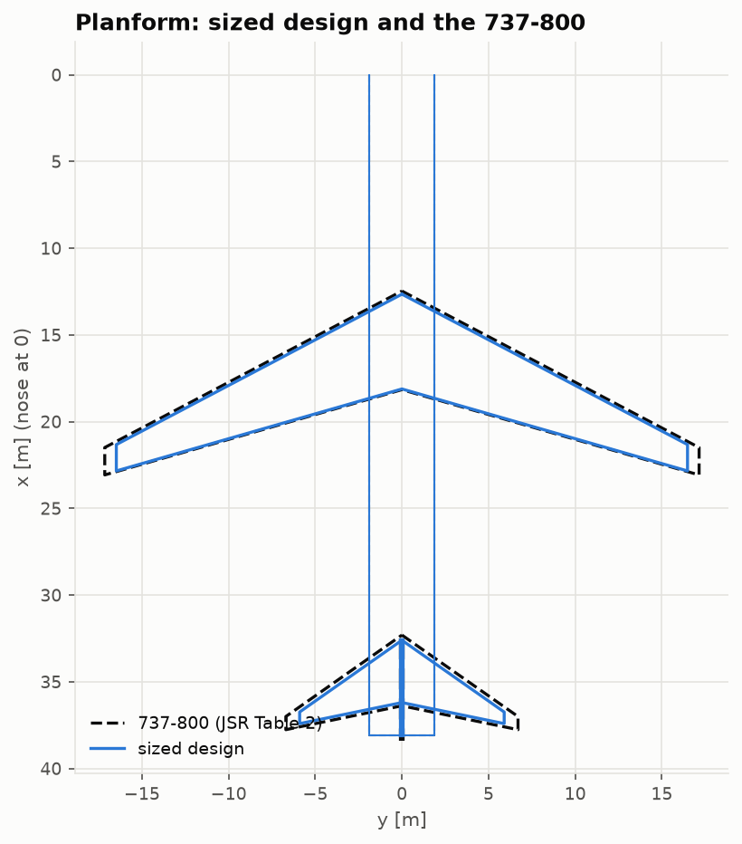
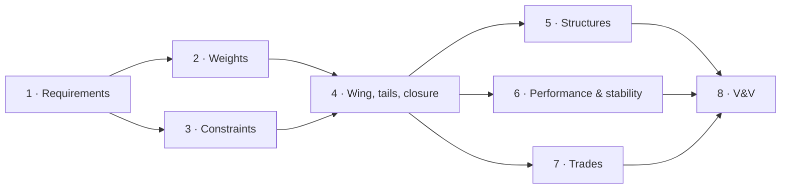

# Aircraft conceptual design from scratch: the course

Eight lessons size a 160-seat, 2,800 nmi airliner from its requirements, using the four
pillar projects as libraries:
- the aerodynamics of AERO-01;
- the structures of AERO-02;
- the propulsion of AERO-03;
- the flight dynamics of AERO-04.

Each lesson derives the method, runs the code in this repository, and checks the result
against exact results, independent methods, or the **Boeing 737-800** that serves as the
reference aircraft. Each ends with exercises, answers included.



## Lessons

| # | Lesson | You will learn | Key result |
|---|---|---|---|
| 1 | [Requirements and the reference aircraft](01-requirements-and-reference.md) | mission requirements, airport-planning charts, labelling data | a design mission the 737-800 flies at its MTOW to ~1 % |
| 2 | [Weight estimation](02-weight-estimation.md) | the weight equation, Breguet fractions, the snowball, class II | class I lands 1.7 % above MTOW; uncalibrated class II puts the 737's OEW 11.7 % low |
| 3 | [The constraint diagram](03-constraint-diagram.md) | T/W against W/S, the master equation, thrust lapse | design point 4 % / 6 % below the 737's; its field lengths imply CLmax,TO = 2.09 |
| 4 | [Wing and tail sizing, and closing the design](04-wing-and-tail-sizing.md) | planforms, Göthert, drag build-up, the sizing loop | 70.0 t against 79.0 t; aerodynamics agree, weights carry the class II bias |
| 5 | [Structural sizing check](05-structural-sizing-check.md) | loads with inertia relief, skin-stringer boxes | physics wing within 2 % of the statistical one |
| 6 | [Performance and stability verification](06-performance-and-stability.md) | mission integration, balance, derivatives from geometry, flying qualities | +5 % range over Breguet; 33 % static margin; needs a yaw damper |
| 7 | [Trade studies](07-trade-studies.md) | re-sizing trades, carpet plots | A ≈ 12, BPR 6.5–8, FL370; LEAP-1B −8 % fuel |
| 8 | [Verification and validation](08-verification-and-validation.md) | check hierarchies, locating an error, calibrating or not | the OEW shortfall located by independent checks |



## Prerequisites

- The four pillar courses help but are not required. Each lesson recalls what it uses.
- Basic flight mechanics: lift, drag, L/D, the standard atmosphere.
- Enough Python and NumPy to read a 50-line function.

## How to use it

1. Read the lesson.
2. Run the matching notebook in [`notebooks/`](../../notebooks) and change the requirements
   or the design choices.
3. Open the code linked at the top of each lesson.
4. Do the exercises before opening the answers.

```bash
uv sync
uv run --with jupyterlab jupyter lab notebooks/
```

The figures are the validation figures of [`validation/`](../../validation), regenerated
by `uv run python validation/run_all.py`.

## Data

- Boeing, *Next-Generation 737 Airplane Characteristics for Airport Planning*, D6-58325-7
  Rev C (2025);
- L. R. Jenkinson, P. Simpkin & D. Rhodes, *Civil Jet Aircraft Design* (1999), Data A;
- ICAO Aircraft Engine Emissions Databank and EASA type-certificate data sheets (through
  AERO-03).

All are transcribed with page or table numbers in
[`validation/reference_data/`](../../validation/reference_data). Everything that is assumed
rather than published is labelled as an assumption.

## Reference texts

- D. P. Raymer, *Aircraft Design: A Conceptual Approach*: the method's backbone.
- D. P. Wells, B. L. Horvath & L. A. McCullers, *The Flight Optimization System Weights
  Estimation Method*, NASA/TM-2017-219627 (2017).
- E. Torenbeek, *Synthesis of Subsonic Airplane Design*.
- J. D. Mattingly, W. H. Heiser & D. T. Pratt, *Aircraft Engine Design*.
- L. K. Loftin, *Subsonic Aircraft: Evolution and the Matching of Size to Performance*,
  NASA RP-1060 (1980).
- B. Etkin & L. D. Reid, *Dynamics of Flight: Stability and Control*.
